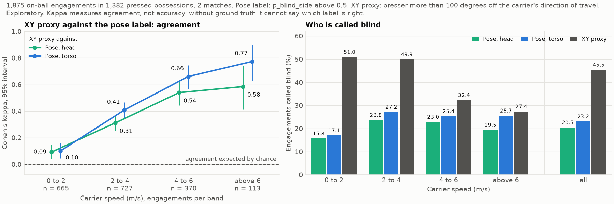
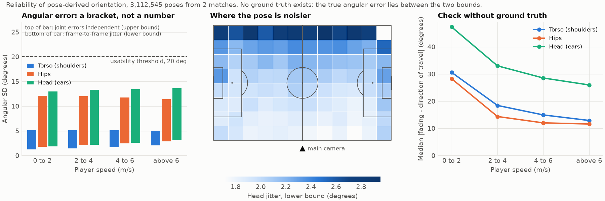

# blindside

**Who is pressed from the blind side? Broadcast body pose against the XY proxy, with honest uncertainty.**

Entry for the SkillCorner X PySport Analytics Cup 2.0, theme Defensive Positioning.
Video: _link added at submission_. The sections follow it.

## What we did

We measured where a ball carrier faces from SkillCorner's broadcast body pose (29 joints, 25 fps, two matches),
with its measurement error, and asked of 1,875 on-ball engagements whether the presser came from outside the
carrier's visual field.

- The XY proxy (presser more than 100 degrees off the direction of travel) calls **45.5%** of engagements blind.
  Head pose calls **20.5%**, torso pose 23.2%.
- The two agree beyond chance only when the carrier runs. Cohen's kappa against the head label is 0.09 below 2 m/s,
  0.31 at 2 to 4, 0.54 at 4 to 6 and 0.58 above 6 m/s (overall 0.28, 95% interval 0.24 to 0.31).
- A pre-registered test found **no detectable increment** of pose over XY for possession loss.



Exploratory, no outcome used. Kappa measures agreement, not accuracy: without ground truth,
"pose carries orientation that XY lacks" and "one of the labels is noisy" cannot be separated.

## Why this problem matters

Pressing a ball carrier from outside their visual field is a coaching staple, but XY tracking has no body
orientation. Analysts fall back on a proxy: the presser comes from behind the carrier's direction of travel.
Body pose lets us check whom that proxy labels:

- **Carrier below 2 m/s** (35% of engagements): proxy and pose label agree barely beyond chance.
  Do not count blind-side presses from XY alone.
- **Carrier above 4 m/s**: kappa 0.54 to 0.77 across head and torso. The XY proxy is a workable stand-in.
- **Read `p_blind_side` under both bounds.** Between 0.1 and 0.9 the press is undecided: 56 engagements under
  the lower bound, 342 under the upper (head).

## How we solved it, with uncertainty bounds

1. **Orientation with uncertainty.** Torso, hip and head facing come from the shoulder, hip and ear pairs in the
   ground plane. Every joint ships with a predicted error (`p90_mae_cm`). We treat it as an isotropic Gaussian
   (sigma = p90 / 2.5, an assumption, varied from 2.0 to 3.0) and propagate it by Monte Carlo into a circular
   standard deviation.
2. **A bracket, not a number.** Independent joint errors overstate the angular noise if joint errors are correlated.
   The Monte Carlo SD is therefore the upper bound and the frame-to-frame jitter of the angle the lower bound: torso 1.4 to 5.1 degrees, hips 2.0 to 12.0, head 2.0 to 13.2. The true error lies between them.
3. **Reliability map.** Above 6 m/s the hip facing lies within 90 degrees of the direction of travel in 99.7% of
   poses. The published joint error is flat across the pitch, the jitter grows by up to 55% towards the far touchline.
4. **`p_blind_side`.** The share of facing samples for which the presser lies outside a visual field of 100 degrees
   to each side, computed under both bounds.



Prior art: SkillCorner's reference helper (MIT) gates shoulder orientation with a hard 15 cm threshold.
This package propagates the error instead.

**The pre-registered test: what 217 events can resolve.** Before any outcome was joined to pose,
[docs/PREREGISTRATION.md](docs/PREREGISTRATION.md) fixed the outcome (possession loss of the pressed possession),
an XY baseline fitted on the 18 matches without pose, four pose features, the model and the resampling,
clustered by possession.

- Resolution: with 217 possession losses, the unpenalised coefficient of `p_blind_side` has an odds ratio
  interval of 0.84 to 1.47 per standard deviation: an effect up to about 1.5 could not have been told from zero.
- Result: adding the pose features changes the out-of-sample log loss by minus 0.0002 (95% intervals within minus
  0.0004 to 0.0000) under both bounds, and none of ten robustness checks changes that. The blind-side metric is
  implemented and geometrically verified, not validated as an explanatory variable.

## Implications and open-source reuse

- **Rerun on more data.** The design is frozen (pre-registration, baseline, features, one command) and reruns
  unchanged when more matches with body pose are published.
- **Matches without pose.** `classify_xy_reliability(carrier_speed)` marks an XY blind-side label as `unreliable`
  below 2 m/s and `reliable` from 4 m/s.
- **A package.** It installs on its own (`pip install .`):

```python
import numpy as np
from blindside import blind_side_probability, bound_correlation, sample_facing_angles

# Carrier facing +x, ears 18 cm apart, 6 cm p90 error, presser behind the left shoulder.
ears = dict(left_xy=[[0.0, 0.09]], right_xy=[[0.0, -0.09]], left_p90_cm=[6.0], right_p90_cm=[6.0])
for bound in ("lower", "upper"):
    rho = bound_correlation("head", bound)
    facing = sample_facing_angles(**ears, correlation=rho, rng=np.random.default_rng(0))
    p = blind_side_probability(facing, carrier_xy=[[0.0, 0.0]], presser_xy=[[-1.0, 3.0]])
    print(f"p_blind_side, {bound} bound: {p[0]:.2f}")  # 1.00 and 0.73
```

[examples/quickstart.py](examples/quickstart.py) runs the package on a pose file: angles with both bounds,
then `p_blind_side`.

## Reproduce

Requires [uv](https://docs.astral.sh/uv/). The repository holds no data: it is downloaded from
SkillCorner's open data ([GitHub](https://github.com/SkillCorner/opendata),
[Hugging Face](https://huggingface.co/datasets/SkillCorner/opendata-bodypose)) at pinned revisions and verified by sha256.

```
uv sync
uv run blindside reproduce --fast        # sample phase, about 1 minute, 100 MB
uv run blindside reproduce               # both figures, about 13 minutes, 1.4 GB
uv run blindside reproduce --with-test   # plus the pre-registered test, 3 GB
uv run pytest
```

`--fast` runs on a 12.3 s sample with two engagements and writes stamped stand-ins to `outputs/fast/`.
The full run writes both figures to `docs/figures/`.

## Limitations

- Two matches. The intervals describe the sampling of possessions inside them.
- No ground truth for orientation. The ear axis stands in for gaze, and a carrier who scanned half a second
  earlier counts as blind.
- The error model and the visual field are assumptions, each with a sensitivity check.

Details: [feasibility](docs/FEASIBILITY.md), [reliability](docs/RELIABILITY.md), [baseline](docs/BASELINE.md),
[incremental value](docs/INCREMENTAL.md), [exploratory](docs/EXPLORATORY_DYNAMIC_EVENTS.md).

## Libraries and licence

numpy, pandas, scikit-learn and scipy (BSD-3-Clause), pyarrow (Apache-2.0), matplotlib (Matplotlib licence),
mplsoccer, pytest, ruff and hatchling (MIT). All analysis code is new for this entry. Licence: MIT, see [LICENSE.md](LICENSE.md).
