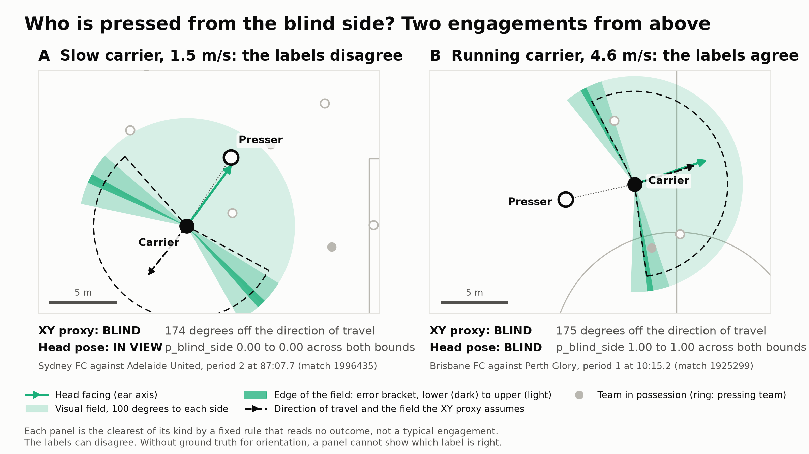

# EXPLORATORY_DYNAMIC_EVENTS.md

`p_blind_side` against SkillCorner's possession labels and defending phases, two engagements drawn on the pitch,
and a helper for matches without body pose.

**Status: exploratory, not pre-registered.** Written on 12 November 2026, after the pre-registered result of
docs/INCREMENTAL.md was known. docs/PREREGISTRATION.md is unchanged, the primary comparison was not rerun and nothing here
can replace it. The primary result stands: no detectable increment of the pose features for possession loss.

What that means for reading this page:

- Section 2.2 sets `p_blind_side` against four columns of the pressed possession. They were chosen after the null result,
  three of them describe the possession after the engagement started, and no XY context is adjusted for.
  A difference between bins is a description of two matches. It is not an effect of pressing from the blind side.
- Section 2.3 and the figure use no outcome column.
- Nothing on this page is validated. The blind-side metric remains implemented, not validated.

## 1. Two engagements on the pitch



Drawn for the video walkthrough by `uv run python scripts/tactical_case_study.py`. It is not a README figure.

How the two engagements were chosen (`blindside.analysis.case_study.case_study_candidates`, no outcome column is read):

| Panel | Rule | Candidates of 1,875 | Chosen |
|---|---|---|---|
| A | Carrier at 1 to 2 m/s, XY proxy blind, head and torso `p_blind_side` below 0.1 under both bounds | 82 | Largest proxy angle minus head-to-presser angle |
| B | Carrier at 4 m/s or faster, XY proxy blind, head and torso `p_blind_side` above 0.9 under both bounds | 58 | Largest proxy angle plus head-to-presser angle |

Both rules also require a carrier pose without a flip flag and at most 8 m between the players.

- **Panel A**, Sydney FC against Adelaide United (match 1996435), period 2 at 87:07.7, event `9_949`. The carrier drifts at 1.5 m/s
  away from the presser, who stands 174 degrees off the direction of travel: the XY proxy calls the press blind. The carrier's
  head points at the presser (4 degrees off), `p_blind_side_head` is 0.00 under both bounds. Head SD 2.5 degrees (lower bound)
  to 14.4 (upper).
- **Panel B**, Brisbane FC against Perth Glory (match 1925299), period 1 at 10:15.2, event `9_119`. The carrier runs at 4.6 m/s,
  head and direction of travel almost coincide, and the presser comes from behind both (175 degrees off the direction of travel,
  174 off the head). `p_blind_side_head` is 1.00 under both bounds. Head SD 1.6 to 10.5 degrees.

Limits of the figure:

- These are the clearest cases, not typical ones. In both, `p_blind_side` is 0 or 1 under either bound, so the error bracket at the
  edge of the visual field does not decide the label. It decides it for the engagements in the uncertain bin
  (56 under the lower bound, 342 under the upper, head).
- Panel A shows that the two labels can disagree. It does not show that the XY proxy is wrong: there is no ground truth for
  orientation, and the ear axis stands in for gaze.
- The other players come from the 10 fps tracking at the engagement start, presser and carrier from the pose frame nearest to it.

## 2. Possession labels and defending phases

Reproduce with `uv run python scripts/exploratory_dynamic_events.py --write-docs` (under a minute with warm caches).
The block below is generated by that script.

<!-- exploratory:start (generated by scripts/exploratory_dynamic_events.py, do not edit by hand) -->
### 2.1 Sample and coverage

1,875 included on-ball engagements in 1,382 pressed possessions, the test set of docs/INCREMENTAL.md section 1.2. Each possession column is read from the `player_possession` row that the engagement points to (`associated_player_possession_event_id`). Engagements of one possession share its values, which the cluster bootstrap accounts for.

| Column | Engagements with a value | Share, % | Tabulated as | Overall |
|---|---|---|---|---|
| `possession_epv_delta_for` | 1,856 | 99.0 | mean | 0.0013 |
| `passing_option_ease_end` | 1,845 | 98.4 | share graded `hard` or `very_hard`, % | 36.7 |
| `time_to_impact_end` | 1,845 | 98.4 | share graded `hard` or `very_hard`, % | 62.1 |
| `space_constraint_start` | 1,838 | 98.0 | share graded `hard` or `very_hard`, % | 24.7 |

### 2.2 Possession columns by bin of `p_blind_side`

Bins as fixed in docs/PREREGISTRATION.md section 11. Intervals: cluster bootstrap over possessions, 2,000 resamples, stratified by match, percentile 95%. Bins below 50 engagements carry no interval. Each cell also gives the engagements with a value.

`possession_epv_delta_for`, mean:

| Feature | Bound | below 0.1 (in view) | 0.1 to 0.9 (uncertain) | above 0.9 (blind) |
|---|---|---|---|---|
| `p_blind_side_head` | lower | 0.0015 (0.0004 to 0.0028), n = 1,446 | -0.0003 (-0.0051 to 0.0039), n = 55 | 0.0009 (-0.0008 to 0.0028), n = 355 |
| `p_blind_side_head` | upper | 0.0016 (0.0003 to 0.0030), n = 1,271 | 0.0008 (-0.0005 to 0.0024), n = 340 | 0.0009 (-0.0012 to 0.0033), n = 245 |
| `p_blind_side_torso` | lower | 0.0014 (0.0002 to 0.0028), n = 1,403 | 0.0005, n = 42 | 0.0011 (-0.0005 to 0.0029), n = 411 |
| `p_blind_side_torso` | upper | 0.0014 (0.0001 to 0.0028), n = 1,345 | 0.0015 (-0.0007 to 0.0041), n = 149 | 0.0010 (-0.0006 to 0.0029), n = 362 |

`passing_option_ease_end`, share graded `hard` or `very_hard`, %:

| Feature | Bound | below 0.1 (in view) | 0.1 to 0.9 (uncertain) | above 0.9 (blind) |
|---|---|---|---|---|
| `p_blind_side_head` | lower | 36.2 (33.1 to 39.3), n = 1,436 | 50.0 (37.5 to 63.2), n = 54 | 36.6 (31.3 to 42.0), n = 355 |
| `p_blind_side_head` | upper | 34.9 (31.7 to 38.1), n = 1,262 | 43.5 (38.0 to 49.1), n = 338 | 36.3 (30.0 to 42.9), n = 245 |
| `p_blind_side_torso` | lower | 35.9 (32.7 to 39.0), n = 1,393 | 66.7, n = 42 | 36.3 (31.4 to 41.5), n = 410 |
| `p_blind_side_torso` | upper | 35.6 (32.3 to 38.8), n = 1,335 | 49.3 (41.1 to 57.5), n = 148 | 35.6 (30.4 to 41.2), n = 362 |

`time_to_impact_end`, share graded `hard` or `very_hard`, %:

| Feature | Bound | below 0.1 (in view) | 0.1 to 0.9 (uncertain) | above 0.9 (blind) |
|---|---|---|---|---|
| `p_blind_side_head` | lower | 59.2 (56.1 to 62.2), n = 1,436 | 68.5 (55.6 to 80.8), n = 54 | 73.0 (68.2 to 77.6), n = 355 |
| `p_blind_side_head` | upper | 57.8 (54.5 to 60.8), n = 1,262 | 71.3 (66.2 to 76.4), n = 338 | 71.8 (66.3 to 77.4), n = 245 |
| `p_blind_side_torso` | lower | 58.9 (55.7 to 61.9), n = 1,393 | 76.2, n = 42 | 71.7 (67.2 to 76.4), n = 410 |
| `p_blind_side_torso` | upper | 58.1 (54.9 to 61.3), n = 1,335 | 73.6 (66.7 to 80.6), n = 148 | 72.1 (67.2 to 76.9), n = 362 |

`space_constraint_start`, share graded `hard` or `very_hard`, %:

| Feature | Bound | below 0.1 (in view) | 0.1 to 0.9 (uncertain) | above 0.9 (blind) |
|---|---|---|---|---|
| `p_blind_side_head` | lower | 21.7 (19.0 to 24.5), n = 1,427 | 27.3 (15.8 to 39.6), n = 55 | 36.2 (31.0 to 41.5), n = 356 |
| `p_blind_side_head` | upper | 20.3 (17.5 to 23.2), n = 1,254 | 33.7 (28.4 to 39.5), n = 338 | 34.6 (28.3 to 40.9), n = 246 |
| `p_blind_side_torso` | lower | 21.6 (18.8 to 24.5), n = 1,386 | 34.1, n = 41 | 34.3 (29.5 to 39.6), n = 411 |
| `p_blind_side_torso` | upper | 21.5 (18.7 to 24.5), n = 1,328 | 29.9 (22.4 to 37.6), n = 147 | 34.2 (29.1 to 39.6), n = 363 |

Blind bin minus in-view bin, all columns:

| Column | Feature | Bound | Blind minus in view (95% interval), EPV or points | Interval excludes zero |
|---|---|---|---|---|
| `possession_epv_delta_for` | `p_blind_side_head` | lower | -0.0006 (-0.0021 to +0.0009) | no |
| `possession_epv_delta_for` | `p_blind_side_head` | upper | -0.0007 (-0.0024 to +0.0011) | no |
| `possession_epv_delta_for` | `p_blind_side_torso` | lower | -0.0003 (-0.0016 to +0.0012) | no |
| `possession_epv_delta_for` | `p_blind_side_torso` | upper | -0.0004 (-0.0018 to +0.0011) | no |
| `passing_option_ease_end` | `p_blind_side_head` | lower | +0.4 (-5.0 to +5.9) | no |
| `passing_option_ease_end` | `p_blind_side_head` | upper | +1.4 (-5.3 to +8.4) | no |
| `passing_option_ease_end` | `p_blind_side_torso` | lower | +0.4 (-4.7 to +6.1) | no |
| `passing_option_ease_end` | `p_blind_side_torso` | upper | +0.1 (-5.4 to +5.9) | no |
| `time_to_impact_end` | `p_blind_side_head` | lower | +13.8 (+8.6 to +18.8) | yes |
| `time_to_impact_end` | `p_blind_side_head` | upper | +14.1 (+8.1 to +20.1) | yes |
| `time_to_impact_end` | `p_blind_side_torso` | lower | +12.8 (+8.0 to +17.9) | yes |
| `time_to_impact_end` | `p_blind_side_torso` | upper | +14.0 (+8.7 to +19.4) | yes |
| `space_constraint_start` | `p_blind_side_head` | lower | +14.5 (+9.1 to +19.7) | yes |
| `space_constraint_start` | `p_blind_side_head` | upper | +14.2 (+8.0 to +20.6) | yes |
| `space_constraint_start` | `p_blind_side_torso` | lower | +12.7 (+7.8 to +18.2) | yes |
| `space_constraint_start` | `p_blind_side_torso` | upper | +12.6 (+7.5 to +18.1) | yes |

8 of 16 intervals exclude zero. They are not independent: the two bounds and the two body segments describe almost the same engagements. No correction for multiple comparisons is applied, because no claim is tested here.

### 2.3 Defending phases

Defending phase of the pressing team: `team_out_of_possession_phase_type` of the row of `phases_of_play.csv` whose frame range holds the engagement start (`frame_start <= t0 < frame_end`). 0 engagements start between two phases. The engagement row of the dynamic events carries a column of the same name. It gives the same phase for 1,641 of 1,875 engagements (87.5%). Why the two differ for the rest was not investigated. The pre-registered baseline uses the column of the engagement row and is not affected.

Pose label: `p_blind_side` above 0.5, lower bound (the upper bound changes the shares by at most a few tenths of a point, docs/INCREMENTAL.md section 1.10). XY proxy: presser more than 100 degrees off the carrier's direction of travel. Kappa: Cohen's kappa of the proxy against the pose label, cluster bootstrap 95% interval, none below 50 engagements. No outcome column is used.

| Defending phase | Engagements | Pose blind, head, % | Pose blind, torso, % | Proxy blind, % | Kappa, head (95% interval) | Kappa, torso (95% interval) |
|---|---|---|---|---|---|---|
| all | 1,875 | 20.5 | 23.2 | 45.5 | +0.28 (+0.24 to +0.31) | +0.35 (+0.31 to +0.39) |
| `low_block` | 659 | 18.8 | 20.2 | 39.3 | +0.28 (+0.21 to +0.35) | +0.35 (+0.28 to +0.43) |
| `medium_block` | 594 | 21.4 | 24.7 | 51.2 | +0.25 (+0.18 to +0.31) | +0.31 (+0.25 to +0.38) |
| `high_block` | 301 | 17.9 | 22.6 | 55.1 | +0.18 (+0.10 to +0.25) | +0.23 (+0.15 to +0.32) |
| `chaotic` | 173 | 26.6 | 28.9 | 37.6 | +0.49 (+0.36 to +0.62) | +0.63 (+0.50 to +0.74) |
| `defending_quick_break` | 50 | 22.0 | 26.0 | 38.0 | +0.26 (-0.05 to +0.56) | +0.37 (+0.05 to +0.67) |
| `defending_set_play` | 43 | 25.6 | 27.9 | 46.5 | +0.37 | +0.42 |
| `defending_transition` | 39 | 23.1 | 23.1 | 33.3 | +0.62 | +0.62 |
| `defending_direct` | 16 | 18.8 | 18.8 | 43.8 | +0.46 | +0.46 |

Median carrier speed per phase in m/s, for reading the kappa column: `low_block` 2.9, `medium_block` 2.4, `high_block` 2.2, `chaotic` 2.9, `defending_quick_break` 3.6, `defending_set_play` 2.6, `defending_transition` 4.4, `defending_direct` 3.3.
<!-- exploratory:end -->

## 3. Reading of the tables

- **`possession_epv_delta_for` and `passing_option_ease_end` do not differ between the blind and the in-view bin.**
  Every interval of the difference includes zero. This is in line with the pre-registered null for possession loss.
- **`time_to_impact_end` and `space_constraint_start` are graded hard more often in the blind bin**, by 13 to 15 points,
  for head and torso and under both bounds. The most economical reading is geometric, not perceptual: both grades describe how close
  opponents are, and a presser arriving from behind goes with a carrier who is already hemmed in. `space_constraint_start` is
  measured at the start of the possession, so it describes the situation the press met, not something the press produced.
  No XY context is adjusted for here. In the pre-registered test, where it is, the pose features add nothing.
- **The uncertain bin stands out for `passing_option_ease_end`** (44% to 50% graded hard against 35% to 36% in the in-view bin).
  This was not looked for, and under the lower bound the bin is small (54 engagements for the head, 42 for the torso).
  Noted, not interpreted.
- **By defending phase, the XY proxy calls far more presses blind than the pose label in every phase.** The gap is widest in
  `high_block` (55.1% against 17.9%, head) and narrowest in `chaotic` (37.6% against 26.6%). Agreement follows the same order:
  kappa 0.18 in `high_block`, 0.49 in `chaotic`. The carrier speed alone does not explain that order (median 2.2 m/s in
  `high_block`, 2.9 in both `low_block` and `chaotic`), so the phase may carry something beyond the speed bands of
  docs/INCREMENTAL.md section 1.10. That is a hypothesis for more matches, not a finding.
- As everywhere, kappa measures agreement, not accuracy. Low agreement cannot say which label is right:
  "pose carries orientation that XY lacks" and "one label is noisy" are not separable without ground truth.

## 4. Blind-side labels on matches without body pose

18 of the 20 open matches have no body pose. There the XY proxy is the only blind-side label, and section 1.10 of
docs/INCREMENTAL.md says when it agrees with the pose label. `blindside.features.xy_proxy` turns that into a filter:

```python
from blindside import classify_xy_reliability, xy_blind_side_proxy
from blindside.features.xy_baseline import baseline_table

table = baseline_table(
    2017461, with_outcomes=False
)  # any match of the open data, tracking is downloaded
table["xy_blind"] = xy_blind_side_proxy(table["approach_angle_heading_deg"])
table["xy_reliability"] = classify_xy_reliability(table["carrier_speed"])
usable = table[table["xy_reliability"] == "reliable"]
```

| Class | Carrier speed | Kappa against the head label | Kappa against the torso label | Share of engagements in the pose matches |
|---|---|---|---|---|
| `unreliable` | below 2 m/s | 0.09 | 0.10 | 35% (665) |
| `intermediate` | 2 to below 4 m/s | 0.31 | 0.41 | 39% (727) |
| `reliable` | 4 m/s and above | 0.54 to 0.58 | 0.66 to 0.77 | 26% (483) |

Status: implemented and unit tested. The thresholds come from two matches of one competition and are not validated elsewhere.
"Reliable" means that the proxy agrees with the pose label, not that either is accurate.
Dropping the `unreliable` class removes about a third of all engagements, and not at random: slow carriers are the ones
who receive with their back to play, which is where a blind side matters most. Report the share that was dropped.
