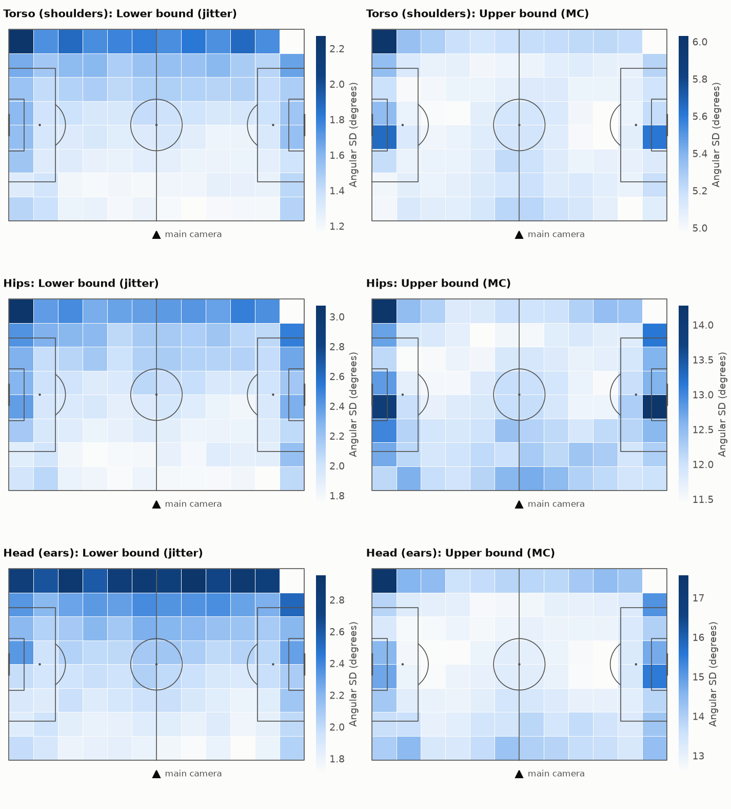
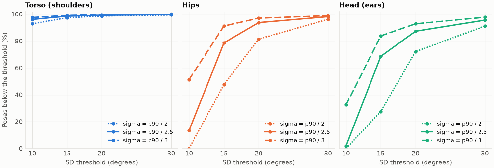
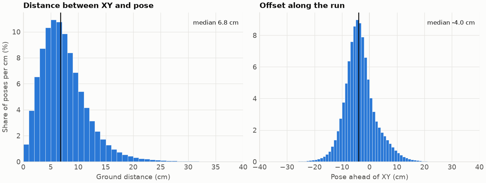
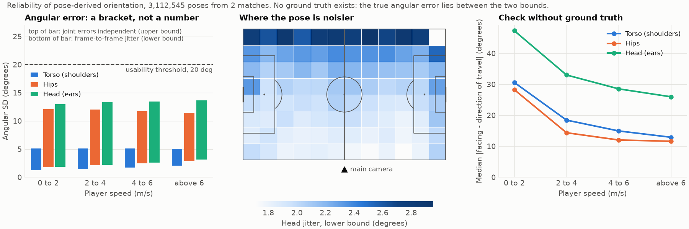

# RELIABILITY.md

Where and when is pose-derived orientation usable? Phase 2 of docs/PLAN.md.
Status: done on 10 November 2026. Section 1 is the uncertainty bracket, section 2 the reliability map,
section 3 the findings. No event or outcome column was read for any of it.

## 1. The angular uncertainty is a bracket, not a number

There is no ground truth for body orientation in this dataset, so the angular error cannot be measured.
`blindside` therefore reports two bounds and carries both through every downstream quantity.

**The true angular error of a pose lies between the lower and the upper bound. Where inside the bracket it lies
cannot be identified without ground truth.**

- **Upper bound.** The Monte Carlo SD under the error model of CLAUDE.md with independent joint errors.
  If the errors of the left and the right joint of a segment are positively correlated, the true angular error is smaller.
- **Lower bound.** The frame-to-frame jitter of the angle itself, after removing a local quadratic trend.
  Any error that is smooth over a fifth of a second (a pose model that filters over time, a slowly drifting bias,
  a wrong skeleton scale) leaves no trace in the jitter, so the true angular error is at least this large.

Reproduce with `uv run python scripts/uncertainty_bracket.py --write-docs`. The block below is generated by that script.

<!-- bracket:start (generated by scripts/uncertainty_bracket.py, do not edit by hand) -->
### 1.1 Definitions

- **Upper bound**: median of the Monte Carlo SD under independent joint errors (`{segment}_sd_deg`, isotropic Gaussian, sigma = p90 / 2.5).
- **Lower bound (jitter)**: each angle is compared with a least-squares quadratic fitted to the unwrapped angle in a window centred on it. Windows: 5 frames (0.2 s, residual variance factor 0.514), 11 frames (0.4 s, residual variance factor 0.793). Only gap-free runs of one player are used.
- **Conversion to an SD**: 1.4826 times the median absolute residual, divided by the square root of the residual variance factor. The factor is the variance that the centre residual of the fit has for white noise of unit variance. The median-based scale keeps sharp real turns from being counted as noise.
- **Lower / upper**: every residual is divided by the residual SD that its own Monte Carlo SD predicts, and the robust SD of these values is reported (0.2 s window). 1 would mean that the Monte Carlo SD is white noise from frame to frame.
- **Reconciling correlation**: `1 - (lower / upper)^2`, the correlation between the errors of the left and the right joint at which the Monte Carlo SD equals the lower bound (the `correlation` parameter of `blindside.geometry.uncertainty`).
- Data: 3,112,545 poses of both full pose matches. All numbers in this block are produced by `scripts/uncertainty_bracket.py`.

### 1.2 The bracket per segment

| Segment | Poses | Lower bound, deg (0.2 s) | Lower bound, deg (0.4 s) | Upper bound, deg | Lower / upper | Reconciling correlation |
|---|---|---|---|---|---|---|
| torso | 3,071,025 | 1.4 | 1.9 | 5.1 | 0.25 | 0.935 |
| hips | 3,070,265 | 2.0 | 2.7 | 12.0 | 0.16 | 0.975 |
| head | 3,071,029 | 2.0 | 2.7 | 13.2 | 0.14 | 0.979 |

Per match:

| Match | Segment | Poses | Lower bound, deg (0.2 s) | Lower bound, deg (0.4 s) | Upper bound, deg | Lower / upper | Reconciling correlation |
|---|---|---|---|---|---|---|---|
| 1925299 | torso | 1,517,272 | 1.3 | 1.9 | 5.1 | 0.25 | 0.939 |
| 1925299 | hips | 1,516,846 | 2.0 | 2.7 | 12.1 | 0.16 | 0.975 |
| 1925299 | head | 1,517,282 | 2.0 | 2.7 | 13.3 | 0.14 | 0.981 |
| 1996435 | torso | 1,553,753 | 1.4 | 1.9 | 5.1 | 0.26 | 0.931 |
| 1996435 | hips | 1,553,419 | 2.0 | 2.7 | 11.9 | 0.16 | 0.974 |
| 1996435 | head | 1,553,747 | 2.1 | 2.8 | 13.1 | 0.15 | 0.978 |

Carried forward in the orientation table:

| Segment | Correlation used for the lower bound | Median `sd_low_deg` | Median `sd_deg` |
|---|---|---|---|
| torso | 0.935 | 1.3 | 5.1 |
| hips | 0.975 | 2.1 | 12.0 |
| head | 0.979 | 2.0 | 13.2 |

### 1.3 Autocorrelation of the jitter residuals

| Segment | Window | Lag 1 (0.04 s) | Lag 5 (0.2 s) | Lag 25 (1 s) |
|---|---|---|---|---|
| torso | 0.2 s | -0.74 (-0.80) | -0.00 (+0.00) | +0.00 (+0.00) |
| torso | 0.4 s | +0.10 (-0.27) | +0.18 (+0.22) | -0.01 (+0.00) |
| hips | 0.2 s | -0.76 (-0.80) | +0.00 (+0.00) | +0.00 (+0.00) |
| hips | 0.4 s | +0.01 (-0.27) | +0.22 (+0.22) | +0.00 (+0.00) |
| head | 0.2 s | -0.75 (-0.80) | -0.00 (+0.00) | +0.00 (+0.00) |
| head | 0.4 s | +0.07 (-0.27) | +0.20 (+0.22) | -0.00 (+0.00) |

In brackets: the autocorrelation that the fit itself induces on white noise. Residuals are clipped at five robust SDs before correlating.

### 1.4 Camera position

| Match | Frames checked | Bottom image edge towards -y, % | Near edge shorter than far edge, % | Edges meet behind -y touchline, % | Meeting point x, m (IQR) | Meeting point y, m (IQR) | By period (x, y) | Reliable |
|---|---|---|---|---|---|---|---|---|
| 1925299 | 2,143 | 100.0 | 100.0 | 100.0 | 0.4 (1.1) | -68.6 (3.5) | 1: (0.5, -68.5); 2: (0.4, -68.8) | yes |
| 1996435 | 1,917 | 100.0 | 100.0 | 100.0 | -0.2 (4.6) | -77.8 (2.1) | 1: (-0.5, -77.9); 2: (0.0, -77.7) | yes |

Example frames (image corners projected on the pitch, metres):

Match 1925299:

| Pose frame | Top left | Top right | Bottom left | Bottom right | Far edge, m | Near edge, m |
|---|---|---|---|---|---|---|
| 10,000 | (-24.2, 39.0) | (23.3, 39.0) | (-11.5, -14.8) | (11.5, -14.7) | 47.5 | 23.0 |
| 75,000 | (-10.1, 39.0) | (47.9, 39.0) | (-4.7, -16.8) | (21.2, -21.1) | 57.9 | 26.3 |
| 150,000 | (6.5, 39.0) | (40.2, 39.0) | (3.4, -3.3) | (23.5, -7.8) | 33.8 | 20.7 |

Match 1996435:

| Pose frame | Top left | Top right | Bottom left | Bottom right | Far edge, m | Near edge, m |
|---|---|---|---|---|---|---|
| 5,000 | (15.5, 39.0) | (61.3, 39.0) | (7.5, -9.0) | (31.9, -16.5) | 45.9 | 25.4 |
| 60,000 | (-6.3, 39.0) | (54.6, 39.0) | (-3.4, -23.5) | (21.8, -28.4) | 61.0 | 25.7 |
| 135,000 | (-63.8, 39.0) | (-3.6, 39.0) | (-22.7, -35.0) | (-0.2, -28.3) | 60.2 | 23.5 |

### 1.5 The bracket by speed band and by distance to the camera

| Segment | Speed | Poses | Lower bound, deg (0.2 s) | Lower bound, deg (0.4 s) | Upper bound, deg | Lower / upper | Reconciling correlation |
|---|---|---|---|---|---|---|---|
| torso | 0 to 2 m/s | 1,569,960 | 1.2 | 1.6 | 5.1 | 0.23 | 0.949 |
| torso | 2 to 4 m/s | 1,090,789 | 1.5 | 2.1 | 5.1 | 0.28 | 0.924 |
| torso | 4 to 6 m/s | 350,699 | 1.7 | 2.6 | 5.1 | 0.32 | 0.896 |
| torso | above 6 m/s | 59,497 | 2.1 | 3.4 | 5.0 | 0.40 | 0.842 |
| hips | 0 to 2 m/s | 1,569,591 | 1.8 | 2.4 | 12.1 | 0.14 | 0.979 |
| hips | 2 to 4 m/s | 1,090,521 | 2.1 | 2.9 | 12.0 | 0.17 | 0.971 |
| hips | 4 to 6 m/s | 350,585 | 2.4 | 3.5 | 11.7 | 0.20 | 0.962 |
| hips | above 6 m/s | 59,488 | 2.9 | 4.5 | 11.4 | 0.24 | 0.944 |
| head | 0 to 2 m/s | 1,569,963 | 1.8 | 2.4 | 13.0 | 0.13 | 0.983 |
| head | 2 to 4 m/s | 1,090,798 | 2.2 | 3.0 | 13.3 | 0.15 | 0.977 |
| head | 4 to 6 m/s | 350,691 | 2.6 | 3.6 | 13.5 | 0.18 | 0.969 |
| head | above 6 m/s | 59,497 | 3.1 | 4.4 | 13.6 | 0.21 | 0.955 |

| Segment | Distance to camera point | Poses | Lower bound, deg (0.2 s) | Lower bound, deg (0.4 s) | Upper bound, deg | Lower / upper | Reconciling correlation |
|---|---|---|---|---|---|---|---|
| torso | 0 to 60 m | 474,574 | 1.2 | 1.8 | 5.2 | 0.22 | 0.950 |
| torso | 60 to 75 m | 818,403 | 1.3 | 1.8 | 5.1 | 0.24 | 0.942 |
| torso | 75 to 90 m | 1,068,709 | 1.4 | 1.9 | 5.1 | 0.26 | 0.932 |
| torso | above 90 m | 709,339 | 1.6 | 2.1 | 5.1 | 0.29 | 0.916 |
| hips | 0 to 60 m | 474,496 | 1.8 | 2.6 | 12.3 | 0.14 | 0.980 |
| hips | 60 to 75 m | 818,238 | 1.9 | 2.6 | 12.0 | 0.15 | 0.977 |
| hips | 75 to 90 m | 1,068,433 | 2.0 | 2.7 | 11.9 | 0.16 | 0.973 |
| hips | above 90 m | 709,098 | 2.2 | 2.9 | 11.9 | 0.18 | 0.969 |
| head | 0 to 60 m | 474,584 | 1.8 | 2.5 | 13.7 | 0.12 | 0.985 |
| head | 60 to 75 m | 818,408 | 1.9 | 2.6 | 13.0 | 0.14 | 0.981 |
| head | 75 to 90 m | 1,068,700 | 2.1 | 2.7 | 13.0 | 0.15 | 0.978 |
| head | above 90 m | 709,337 | 2.4 | 3.1 | 13.3 | 0.16 | 0.973 |
<!-- bracket:end -->

### 1.6 Reading of the results

Measured:
- **The bracket is wide.** Torso 1.4 to 5.1 degrees, hips 2.0 to 12.0, head 2.0 to 13.2 (lower bound from the 0.2 s window,
  upper bound as the median Monte Carlo SD). The lower bound is 25% of the upper bound for the torso and about 15% for hips and head.
  Both matches give the same bracket to within 0.1 degrees.
- **The upper bound orders the segments by baseline width, the lower bound barely does.** Under the error model the hips and the head
  are 2.4 to 2.6 times noisier than the torso. In the jitter they are 1.5 times noisier.
- **The 0.2 s window is the lower bound that is carried forward.** Its residuals behave like white noise: the lag 1 autocorrelation
  is -0.74 to -0.76 against -0.80 expected for white noise, and it is zero at 0.2 s and 1 s. The residuals of the 0.4 s window
  do not: their lag 1 autocorrelation is +0.01 to +0.10 against -0.27 expected. They contain a component that is smooth over
  neighbouring frames, which is real movement or time-correlated error, and the method cannot tell which.
  The 0.4 s estimate is about 35% larger and is reported as a sensitivity value only.
- **Reconciling correlation.** The Monte Carlo SD equals the lower bound if the errors of the left and the right joint are
  correlated at 0.935 (torso), 0.975 (hips) and 0.979 (head). These are the values in `blindside.geometry.uncertainty.BOUND_CORRELATION`.
  They are defaults for these two matches. `blindside.analysis.calibrate_bound_correlation(table)` recomputes them from any
  orientation table, and a test checks that it returns the defaults on the two pose matches.
- **Speed.** The lower bound rises with speed, by about 60 to 70% from below 2 m/s to above 6 m/s. The upper bound does not move.
- **Distance to the camera.** The lower bound rises by 20 to 30% from the nearest to the farthest band. The upper bound is flat:
  the published `p90_mae_cm` does not grow with the distance to the camera.
- **Camera.** Both matches are filmed from behind the touchline at negative y. Three cues agree in 100% of about 2,000 checked frames
  per match, the meeting point of the image edges lies within 0.5 m of the halfway line, and it does not move at half time.
  The inference is used. The camera point lies 35 to 44 m behind the touchline, which overstates the real stand-off because the
  estimate falls behind a camera that looks downwards. Distances to it rank players correctly and are used for banding only.

What this does not show:
- The reconciling correlations are not estimates of the true correlation between joint errors. They are the values that would
  make the upper bound collapse onto the lower bound. A correlation of 0.98 between two ear positions is one possible reading.
  A published error radius that is conservative, or pose errors that are smooth in time, explain the same gap without any correlation.
- The lower bound is not free of real movement. A quadratic over 0.2 s absorbs most of it and the median-based scale ignores
  sharp turns, but its rise with speed may be real high-frequency movement (stride), noisier poses of fast players, or both.
  The band below 2 m/s is the cleanest reading of pure measurement jitter: torso 1.2, hips 1.8, head 1.8 degrees.
- The lower bound says nothing about bias. A pose that is consistently rotated by 10 degrees has no jitter at all.

Assumptions, labelled:
- Upper bound: isotropic Gaussian joint error, sigma = p90 / 2.5, `p90_mae_cm` calibrated, joints independent.
- Lower bound: real movement is locally quadratic within 0.2 s, the remaining residual is white noise.
- One ratio per segment is applied to all poses when the lower bound is carried forward. Section 1.5 shows that the ratio
  varies with speed (torso 0.23 to 0.40) and less with camera distance. The pooled value is used and this is a simplification.

### 1.7 How both bounds are carried forward

- The orientation table has `{segment}_sd_deg` (upper bound) and `{segment}_sd_low_deg` (lower bound) for torso, hips and head.
  The lower bound is a second Monte Carlo run with the reconciling correlation of the segment, so it keeps the
  pose-by-pose variation of the published joint error.
- Any quantity that samples orientations calls the sampler twice, with `bound_correlation(segment, "upper")` and
  `bound_correlation(segment, "lower")`. This applies in particular to `p_blind_side` in Phase 4, which is reported under both bounds.
- A conclusion counts as robust to the uncertainty model only if it holds under both bounds.

## 2. The reliability map

Where on the pitch, at which speed and for which body segment is the orientation usable, and how well does the
pose agree with the XY tracking it is joined to? Every uncertainty is given under both bounds of section 1.

Reproduce with `uv run python scripts/reliability_map.py --write-docs`. The block below is generated by that script.

<!-- reliability:start (generated by scripts/reliability_map.py, do not edit by hand) -->
### 2.1 Sources and definitions

- Data: 3,112,545 poses of both full pose matches, orientation tables from `blindside.features.cached_orientation_table`. All numbers in this block are produced by `scripts/reliability_map.py`. No event column is read.
- **Upper bound**: Monte Carlo SD under independent joint errors (`{segment}_sd_deg`). **Lower bound**: frame-to-frame jitter from the 0.2 s window (section 1.1), recomputed inside every zone or band.
- **Pitch zones**: 12 x 8 zones on a 105 x 68 m pitch (pitch sizes from match.json: 1925299: 105 x 68 m, 1996435: 105 x 68 m). Positions outside the pitch count in the nearest edge zone. Zones with fewer than 2,000 poses are left out.
- **Distance from the camera touchline**: `y` plus half the pitch width. It needs only the camera side (negative y in both matches, section 1.4), not the inferred camera point.
- **Usable**: angular SD below a threshold, default 20 degrees. The threshold is a convention, not a measured limit.
- **XY to pose offset**: midpoint of lHip and rHip minus the tracking position stored in the same pose record (`centroid_dx_m`, `centroid_dy_m`).

### 2.2 Angular uncertainty by pitch zone

| Segment | Statistic | Zones | Min | Median | Max | Worst zone centre (x, y), m |
|---|---|---|---|---|---|---|
| torso | Lower bound, deg | 95 | 1.2 | 1.4 | 2.3 | (-48, 30) |
| torso | Upper bound, deg | 95 | 5.0 | 5.1 | 6.0 | (-48, 30) |
| torso | Upper bound below 20 deg, % | 95 | 95.6 | 99.3 | 100.0 | (-48, 30) |
| hips | Lower bound, deg | 95 | 1.7 | 2.0 | 3.1 | (-48, 30) |
| hips | Upper bound, deg | 95 | 11.4 | 12.0 | 14.3 | (48, -4) |
| hips | Upper bound below 20 deg, % | 95 | 76.7 | 93.8 | 96.8 | (-48, 30) |
| head | Lower bound, deg | 95 | 1.7 | 2.0 | 3.0 | (13, 30) |
| head | Upper bound, deg | 95 | 12.6 | 13.3 | 17.6 | (-48, 30) |
| head | Upper bound below 20 deg, % | 95 | 58.4 | 87.0 | 93.0 | (-48, 30) |

Median over the zones of each lane parallel to the touchline, degrees:

| Lane centre y, m | Poses | torso, lower | torso, upper | hips, lower | hips, upper | head, lower | head, upper |
|---|---|---|---|---|---|---|---|
| -29.8 | 189,637 | 1.2 | 5.1 | 1.8 | 12.2 | 1.8 | 13.8 |
| -21.2 | 315,448 | 1.2 | 5.1 | 1.9 | 12.1 | 1.9 | 13.5 |
| -12.8 | 437,084 | 1.3 | 5.1 | 1.9 | 12.1 | 1.9 | 13.1 |
| -4.2 | 655,172 | 1.3 | 5.1 | 1.9 | 12.0 | 2.0 | 13.0 |
| 4.2 | 626,548 | 1.4 | 5.1 | 2.0 | 11.9 | 2.0 | 12.9 |
| 12.8 | 410,182 | 1.5 | 5.1 | 2.1 | 11.8 | 2.2 | 12.9 |
| 21.2 | 286,732 | 1.5 | 5.1 | 2.2 | 11.8 | 2.3 | 13.1 |
| 29.8 | 191,742 | 1.8 | 5.2 | 2.4 | 12.2 | 2.8 | 14.1 |

The camera stands behind the first lane (most negative y). Figure: `docs/figures/reliability_zones.png`.

### 2.3 Angular uncertainty by speed and by distance from the camera touchline

By player speed: section 1.5, first table. By distance from the camera touchline:

| Segment | Distance from camera touchline | Poses | Lower bound, deg | Upper bound, deg | Lower / upper |
|---|---|---|---|---|---|
| torso | 0 to 17 m | 493,282 | 1.2 | 5.1 | 0.23 |
| torso | 17 to 34 m | 1,077,848 | 1.3 | 5.1 | 0.24 |
| torso | 34 to 51 m | 1,021,919 | 1.4 | 5.1 | 0.26 |
| torso | above 51 m | 472,539 | 1.6 | 5.1 | 0.30 |
| hips | 0 to 17 m | 493,216 | 1.8 | 12.2 | 0.14 |
| hips | 17 to 34 m | 1,077,687 | 1.9 | 12.1 | 0.15 |
| hips | 34 to 51 m | 1,021,525 | 2.1 | 11.8 | 0.17 |
| hips | above 51 m | 472,400 | 2.3 | 11.9 | 0.18 |
| head | 0 to 17 m | 493,285 | 1.8 | 13.6 | 0.12 |
| head | 17 to 34 m | 1,077,861 | 1.9 | 13.2 | 0.14 |
| head | 34 to 51 m | 1,021,899 | 2.1 | 13.0 | 0.15 |
| head | above 51 m | 472,547 | 2.5 | 13.3 | 0.17 |

### 2.4 Facing versus direction of travel by speed band

| Segment | Speed band | Poses | Median signed difference, deg | Median abs. difference, deg | 90th pct, deg | Share above 90 deg, % | Median abs., 1925299 | Median abs., 1996435 |
|---|---|---|---|---|---|---|---|---|
| torso | 0 to 2 m/s | 1,594,018 | -0.2 | 30.6 | 147.9 | 23.4 | 31.1 | 30.1 |
| torso | 2 to 4 m/s | 1,104,274 | -1.1 | 18.4 | 76.6 | 8.1 | 18.8 | 18.1 |
| torso | 4 to 6 m/s | 353,955 | -2.2 | 14.9 | 40.7 | 1.7 | 15.1 | 14.8 |
| torso | above 6 m/s | 59,974 | -2.7 | 12.9 | 31.6 | 0.3 | 12.9 | 12.9 |
| hips | 0 to 2 m/s | 1,593,891 | 0.0 | 28.3 | 148.7 | 23.4 | 28.8 | 27.8 |
| hips | 2 to 4 m/s | 1,104,169 | -0.4 | 14.4 | 71.0 | 7.6 | 14.3 | 14.4 |
| hips | 4 to 6 m/s | 353,913 | -1.4 | 12.0 | 32.8 | 1.4 | 11.7 | 12.3 |
| hips | above 6 m/s | 59,970 | -1.7 | 11.6 | 27.2 | 0.3 | 11.2 | 11.9 |
| head | 0 to 2 m/s | 1,594,018 | -0.2 | 47.3 | 146.2 | 26.1 | 47.6 | 47.0 |
| head | 2 to 4 m/s | 1,104,280 | -1.7 | 33.0 | 96.4 | 11.4 | 32.9 | 33.1 |
| head | 4 to 6 m/s | 353,951 | -4.1 | 28.5 | 69.3 | 4.2 | 28.2 | 28.8 |
| head | above 6 m/s | 59,974 | -6.1 | 26.0 | 58.8 | 1.1 | 24.4 | 26.9 |

### 2.5 Share of usable poses

| Segment | Bound | Poses | SD median, deg | SD below 10 deg, % | SD below 15 deg, % | SD below 20 deg, % | SD below 30 deg, % |
|---|---|---|---|---|---|---|---|
| torso | upper | 3,112,545 | 5.1 | 96.1 | 98.5 | 99.2 | 99.7 |
| torso | lower | 3,112,545 | 1.3 | 99.8 | 99.9 | 99.9 | 99.9 |
| hips | upper | 3,112,545 | 12.0 | 13.3 | 78.6 | 93.7 | 98.1 |
| hips | lower | 3,112,545 | 2.1 | 99.0 | 99.7 | 99.8 | 99.9 |
| head | upper | 3,112,545 | 13.2 | 2.0 | 68.6 | 87.3 | 95.5 |
| head | lower | 3,112,545 | 2.0 | 99.8 | 99.9 | 99.9 | 99.9 |

Sensitivity of the upper bound to the conversion sigma = p90 / factor:

| Segment | Factor | Poses | SD median, deg | SD below 10 deg, % | SD below 15 deg, % | SD below 20 deg, % | SD below 30 deg, % |
|---|---|---|---|---|---|---|---|
| torso | 2.0 | 3,112,545 | 6.4 | 92.8 | 97.4 | 98.6 | 99.4 |
| torso | 2.5 | 3,112,545 | 5.1 | 96.1 | 98.5 | 99.2 | 99.7 |
| torso | 3.0 | 3,112,545 | 4.2 | 97.5 | 99.0 | 99.5 | 99.8 |
| hips | 2.0 | 3,112,545 | 15.2 | 0.0 | 47.5 | 81.4 | 96.1 |
| hips | 2.5 | 3,112,545 | 12.0 | 13.3 | 78.6 | 93.7 | 98.1 |
| hips | 3.0 | 3,112,545 | 9.9 | 51.3 | 91.1 | 97.0 | 98.8 |
| head | 2.0 | 3,112,545 | 16.8 | 0.0 | 27.5 | 72.1 | 91.1 |
| head | 2.5 | 3,112,545 | 13.2 | 2.0 | 68.6 | 87.3 | 95.5 |
| head | 3.0 | 3,112,545 | 10.9 | 32.4 | 83.8 | 92.8 | 97.7 |

The lower bound has no such sensitivity: it is anchored to the measured jitter, and a different factor changes the reconciling correlation, not the bound. Figure: `docs/figures/reliability_sensitivity.png`.

### 2.6 Offset between XY tracking and the pose centroid

| Speed band | Poses | Median, cm | 90th pct, cm | 99th pct, cm | Share above 0.5 m, % | Median along x, cm | Median along y, cm | Median along direction of travel, cm |
|---|---|---|---|---|---|---|---|---|
| all | 3,112,545 | 6.8 | 12.9 | 22.3 | 0.0008 | 0.1 | -0.9 | -4.0 |
| 0 to 2 m/s | 1,594,048 | 7.1 | 13.2 | 24.2 | 0.0013 | 0.4 | -0.8 | -3.3 |
| 2 to 4 m/s | 1,104,304 | 6.4 | 12.4 | 20.6 | 0.0005 | 0.0 | -1.0 | -4.3 |
| 4 to 6 m/s | 353,961 | 6.5 | 12.6 | 19.6 | 0.0000 | -0.6 | -0.9 | -4.9 |
| above 6 m/s | 59,974 | 7.0 | 12.4 | 18.2 | 0.0000 | -1.1 | -0.8 | -5.7 |

Positive along the direction of travel means that the pose centroid is ahead of the tracking position. Figure: `docs/figures/reliability_misalignment.png`.

### 2.7 Composite figure

`docs/figures/reliability_composite.png`, README figure 1.

<!-- reliability:end -->

## 3. Findings

All numbers are from sections 1 and 2: 3.1 million poses, two matches, one league, one camera set-up.
"Measured" means computed from the data. It does not mean validated against ground truth, which does not exist here.

### 3.1 What is reliable

- **Torso orientation, everywhere.** Bracket 1.4 to 5.1 degrees. Under the upper bound 99.2% of poses have an SD below 20 degrees,
  and 98.6 to 99.5% across the three sigma factors. The worst pitch zone still reaches 95.6%. The torso is the segment
  whose usability does not depend on which bound or which factor one believes.
- **Hips as a direction, at speed.** Above 4 m/s the hips point within 12 degrees (median) of the direction of travel,
  with no bias (minus 1.4 to minus 1.7 degrees) and 0.3% front/back disagreement above 6 m/s. Both matches agree to within 0.7 degrees.
  This is the only external check available and the hips pass it.
- **The left/right labels.** At sprint speed 99.7% of torso and hip angles lie within 90 degrees of the direction of travel.
- **The join between pose and XY tracking.** The hip midpoint lies 6.8 cm (median) from the tracking position, 22 cm at the
  99th percentile, and 0.0008% of poses are off by more than 0.5 m. Presser to carrier geometry at engagement distances
  of metres is not affected. The pose centroid trails the tracking position by 3 to 6 cm along the direction of travel, growing with speed.
  Whether that is a small time offset or the hips sitting behind the tracked body point cannot be told apart here.

### 3.2 What is not reliable, or not known

- **The size of the error of hips and head.** The bracket spans a factor of six: hips 2.0 to 12.0 degrees, head 2.0 to 13.2.
  The share of usable head poses at 20 degrees is 87.3% under the upper bound and 99.9% under the lower bound,
  and under the upper bound alone it moves from 72.1% to 92.8% with the sigma factor (hips 81.4% to 97.0%).
  At a 10 degree threshold it is 2% or 99.8% depending on the bound. A usable share for hips or head is a statement
  about the assumed error model, not about the data.
- **The published joint error does not know where the player is.** The upper bound is flat across the pitch
  (head 12.9 to 14.1 degrees by lane) while the jitter of the same poses rises steadily with distance from the camera:
  head 1.8 degrees in the lane next to the camera, 2.8 in the far lane, plus 55%. Torso 1.2 to 1.8, hips 1.8 to 2.4.
  The far touchline, the goal lines and the far corners are the noisy zones. The worst zone has 58% usable head poses under the upper bound.
- **Speed.** Jitter rises by 60 to 70% from below 2 m/s to above 6 m/s (section 1.5). The upper bound does not move.
- **Head direction against anything else.** At sprint speed the head still differs from the direction of travel by 26 degrees (median),
  twice the torso value, with a bias of minus 6 degrees. Neither bound explains this as noise alone (a pure-noise SD of 13.6 degrees
  gives a median absolute difference of 9 degrees), so the head carries something the body does not: real head turns, a bias of the
  ear axis, or both. This data cannot separate them.
- **Bias in general.** Neither bound sees a constant rotation of a segment. The velocity check limits it for the hips and the torso
  at speed (below 3 degrees). For standing players and for the head nothing limits it.

### 3.3 What an analyst should not build on this data

1. **A single-frame head turn or scanning metric.** The typical head versus torso difference (15 degrees) is the size of the
   head upper bound (13 degrees). Whether it is signal depends entirely on where in the bracket the truth lies.
2. **A hard quality gate on hips or head.** A threshold on the Monte Carlo SD or on `p90_mae_cm` removes between 7% and 28% of head poses
   depending on an unverified conversion factor, and it does not remove the poses that are noisier in the jitter (far side, high speed),
   because the published error does not flag them.
3. **A conclusion that holds under one bound only.** Any pose-derived quantity, `p_blind_side` first of all, has to be computed
   under the lower and the upper bound and reported under both.
4. **Facing as a proxy for movement below 4 m/s.** Below 2 m/s 23% of hip angles point more than 90 degrees away from the direction
   of travel. That is football (backpedalling, side-stepping), not error, and it is why orientation adds information over XY at all.
   It also means the velocity check validates nothing for slow players.
5. **A comparison between pitch areas or between teams that ignores the camera.** A team that defends on the far touchline is
   measured with up to 55% more head jitter than one that defends in front of the camera.
6. **Vertical information.** z is relative to the player and was not used anywhere (CLAUDE.md, known data facts).
7. **A generalisation beyond these two matches.** Same league, same camera side, same pitch size. The bracket and its calibration
   (`calibrate_bound_correlation`) must be recomputed for any other source.

### 3.4 Assumptions, labelled

- Upper bound: isotropic Gaussian joint error, sigma = p90 / 2.5 (sensitivity 2.0 and 3.0 in section 2.5), `p90_mae_cm` calibrated,
  joint errors independent.
- Lower bound: real movement is locally quadratic within 0.2 s, the rest is white noise. Inside a zone or band the jitter is
  recomputed from the residuals of that zone, so the spatial pattern is measured. Only its reading as pure measurement noise is an assumption.
- Usability threshold of 20 degrees: a convention. With a visual field half-angle of 100 degrees it means that the facing direction
  is known to about a fifth of the half-angle.
- Pitch zones: both pitches are 105 x 68 m and both cameras stand at negative y, so pooling needs no mirroring. A third match needs both checked.
- Positions outside the pitch are counted in the nearest edge zone. One of 96 zones has fewer than 2,000 poses and is left blank.

### 3.5 Consequence for the blind-side metric

The torso is the robust channel and the head the informative but uncertain one, as section 4 of docs/FEASIBILITY.md expected.
The reliability map adds two things for Phase 3 and 4: the distance from the camera touchline is a covariate worth reporting
next to any pose feature, and the usability filter of Phase 4 (SD below 20 degrees) selects on the error model, so results
with and without it must both be shown.
