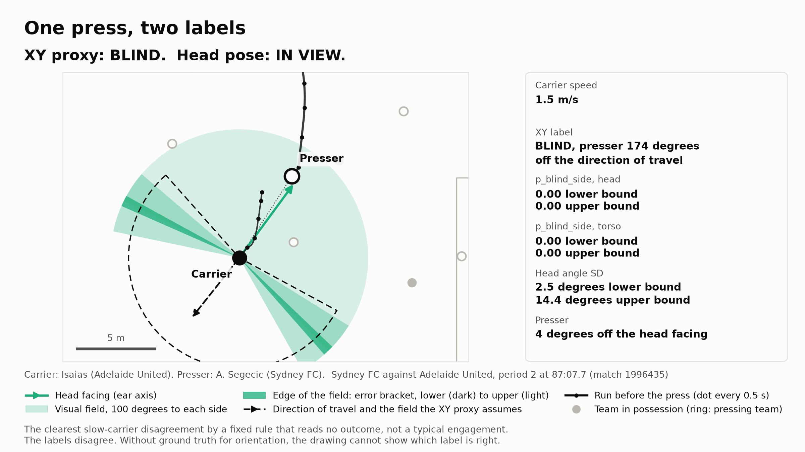

# TACTICAL_INSIGHTS.md

Who presses from the pose blind side, who is pressed that way, where on the pitch, and how many matches a rerun
of the pre-registered test would need.

**Status: exploratory and descriptive, not pre-registered.** Written on 12 November 2026, after the pre-registered result
of docs/INCREMENTAL.md was known. docs/PREREGISTRATION.md is unchanged, the primary comparison was not rerun, and
`p_blind_side` is used exactly as the registered pipeline computes it. No outcome column is read on this page.
The primary result stands: no detectable increment of the pose features for possession loss.

## 1. How to read this page

- **Confidently blind** means `p_blind_side_head` above 0.8 under both bounds of the angular uncertainty. It is a
  statement about the pose label. There is no ground truth for orientation, the ear axis stands in for gaze, and a carrier
  who scanned half a second earlier still counts as blind.
- The counts say how often a press came from outside the measured visual field. They do not say that such a press works:
  the pre-registered test found no increment for possession loss.
- Two matches. A player appears in one of them, with a few dozen engagements. The tables describe these two matches.
  They are not a scouting verdict on a player or a team.
- The metric is implemented and geometrically verified, not validated.

One engagement of the kind that separates the two labels, drawn by `uv run python scripts/plot_scene_example.py`
(or `uv run blindside reproduce --with-scene`):

The carrier backs away at 1.5 m/s while facing the presser. The XY proxy reads the direction of travel and calls
the press blind, the head label calls it in view under both bounds. This is the clearest of 82 candidates of a fixed rule
that reads no outcome (docs/EXPLORATORY_DYNAMIC_EVENTS.md section 1), not a typical engagement. It shows that the labels
disagree, not which one is right.

## 2. Tables

Reproduce with `uv run python scripts/tactical_insights.py --write-docs` (under a minute with warm caches).
The block below is generated by that script.

<!-- insights:start (generated by scripts/tactical_insights.py, do not edit by hand) -->
### 2.1 Sample and label

1,875 included on-ball engagements in 1,382 pressed possessions, the test set of docs/INCREMENTAL.md section 1.2. **Confidently blind**: `p_blind_side_head` above 0.8 under the lower and under the upper bound. 296 engagements (15.8%) qualify. Under the lower bound alone 365 would, under the upper bound alone 296: the stricter upper bound decides. The XY proxy calls 853 (45.5%) blind.

Intervals: cluster bootstrap over possessions, 2,000 resamples, stratified by match, percentile 95%. Groups below 50 engagements carry no interval. Shares of single players rest on a few dozen engagements from one match each. They describe these two matches, not the player.

### 2.2 Pressing teams

| Pressing team | Engagements | Confidently blind | Share, % (95% interval) | XY proxy blind, % |
|---|---|---|---|---|
| Perth Glory | 551 | 97 | 17.6 (14.4 to 20.6) | 44.6 |
| Adelaide United | 543 | 83 | 15.3 (12.2 to 18.4) | 45.3 |
| Sydney FC | 441 | 62 | 14.1 (11.0 to 17.3) | 44.9 |
| Brisbane FC | 340 | 54 | 15.9 (12.1 to 19.7) | 47.9 |

### 2.3 Pressers

The 8 pressers with the most confidently blind presses:

| Presser | Engagements | Confidently blind | Share, % (95% interval) | XY proxy blind, % |
|---|---|---|---|---|
| E. Alagich (LDM, Adelaide United) | 83 | 20 | 24.1 (15.6 to 33.8) | 41.0 |
| A. Cáceres (AM, Sydney FC) | 63 | 18 | 28.6 (18.3 to 39.5) | 44.4 |
| N. Pennington (LM, Perth Glory) | 68 | 16 | 23.5 (13.6 to 34.3) | 42.6 |
| A. Bugarija (CF, Perth Glory) | 75 | 14 | 18.7 (9.6 to 27.8) | 65.3 |
| T. Gomulka (RM, Perth Glory) | 64 | 14 | 21.9 (12.1 to 32.7) | 42.2 |
| S. Mauk (AM, Adelaide United) | 68 | 13 | 19.1 (10.1 to 29.2) | 54.4 |
| Walid Shour (RDM, Brisbane FC) | 53 | 11 | 20.8 (10.6 to 32.5) | 41.5 |
| A. Burke-Gilroy (LB, Brisbane FC) | 31 | 11 | 35.5 | 45.2 |

Pressers with at least 25 engagements, by share:

| Presser | Engagements | Confidently blind | Share, % |
|---|---|---|---|
| A. Burke-Gilroy (LB, Brisbane FC) | 31 | 11 | 35.5 |
| A. Cáceres (AM, Sydney FC) | 63 | 18 | 28.6 |
| E. Alagich (LDM, Adelaide United) | 83 | 20 | 24.1 |
| N. Pennington (LM, Perth Glory) | 68 | 16 | 23.5 |
| T. Gomulka (RM, Perth Glory) | 64 | 14 | 21.9 |
| Walid Shour (RDM, Brisbane FC) | 53 | 11 | 20.8 |
| J. Courtney-Perkins (LB, Sydney FC) | 34 | 7 | 20.6 |
| A. Zimarino (RW, Brisbane FC) | 36 | 7 | 19.4 |

### 2.4 Carriers

The 8 carriers most often pressed confidently blind:

| Carrier | Engagements | Confidently blind | Share, % (95% interval) | XY proxy blind, % |
|---|---|---|---|---|
| J. O'Shea (LDM, Brisbane FC) | 100 | 29 | 29.0 (19.2 to 38.6) | 52.0 |
| A. Cáceres (AM, Sydney FC) | 88 | 20 | 22.7 (14.5 to 31.8) | 45.5 |
| Léo Sena (LDM, Sydney FC) | 93 | 17 | 18.3 (11.2 to 26.1) | 45.2 |
| K. Jelacic (LW, Brisbane FC) | 63 | 14 | 22.2 (11.6 to 33.3) | 39.7 |
| E. Alagich (LDM, Adelaide United) | 51 | 14 | 27.5 (15.5 to 40.7) | 39.2 |
| Walid Shour (RDM, Brisbane FC) | 65 | 12 | 18.5 (9.6 to 27.1) | 44.6 |
| C. Hollman (RDM, Sydney FC) | 54 | 12 | 22.2 (11.5 to 34.9) | 53.7 |
| A. Ouahim (LW, Sydney FC) | 64 | 11 | 17.2 (8.5 to 26.5) | 39.1 |

Carriers with at least 25 engagements, by share:

| Carrier | Engagements | Confidently blind | Share, % |
|---|---|---|---|
| J. O'Shea (LDM, Brisbane FC) | 100 | 29 | 29.0 |
| S. Mauk (AM, Adelaide United) | 32 | 9 | 28.1 |
| E. Alagich (LDM, Adelaide United) | 51 | 14 | 27.5 |
| A. Bugarija (CF, Perth Glory) | 25 | 6 | 24.0 |
| F. Bérenguer (AM, Brisbane FC) | 47 | 11 | 23.4 |
| T. Gomulka (RM, Perth Glory) | 30 | 7 | 23.3 |
| A. Cáceres (AM, Sydney FC) | 88 | 20 | 22.7 |
| K. Jelacic (LW, Brisbane FC) | 63 | 14 | 22.2 |

### 2.5 Pitch zones

`third_start` and `channel_start` of the engagement row. Both are direction-normalised to the pressing team: its `attacking_third` is the third in which the team in possession builds up, its `defensive_third` the one in front of its own goal.

| Third of the pressing team | Engagements | Confidently blind | Share, % (95% interval) | XY proxy blind, % |
|---|---|---|---|---|
| attacking_third | 386 | 42 | 10.9 (8.0 to 14.2) | 48.2 |
| middle_third | 772 | 148 | 19.2 (16.4 to 21.9) | 50.6 |
| defensive_third | 717 | 106 | 14.8 (12.2 to 17.4) | 38.5 |

| Channel | Engagements | Confidently blind | Share, % (95% interval) | XY proxy blind, % |
|---|---|---|---|---|
| wide_left | 372 | 52 | 14.0 (10.5 to 17.4) | 41.9 |
| half_space_left | 396 | 69 | 17.4 (13.9 to 21.3) | 44.4 |
| center | 479 | 93 | 19.4 (15.9 to 23.0) | 48.4 |
| half_space_right | 307 | 33 | 10.7 (7.4 to 14.2) | 44.6 |
| wide_right | 321 | 49 | 15.3 (11.6 to 18.9) | 47.4 |

### 2.6 Sample size for a rerun of the pre-registered design

Starting point (docs/INCREMENTAL.md section 1.9, exploratory): the unpenalised coefficient of `p_blind_side_head` is +0.108 per standard deviation (-0.175 to +0.387, lower bound) with 217 possession losses in 1,875 engagements of 2 matches. That interval implies a standard error of 0.143 on the log odds scale.

Planning approximation: the standard error shrinks with the square root of the number of events, everything else unchanged (event rate, feature distribution, correlation of the head with the torso feature, about 108 possession losses per match). A two-sided Wald test at the 5% level then needs

| Assumed odds ratio per SD | Events, power 50% | Engagements, power 50% | Matches, power 50% | Events, power 80% | Engagements, power 80% | Matches, power 80% |
|---|---|---|---|---|---|---|
| 1.15 | 878 | 7,580 | 9 | 1,793 | 15,487 | 17 |
| 1.25 | 345 | 2,974 | 4 | 704 | 6,076 | 7 |
| 1.50 | 105 | 901 | 1 | 213 | 1,841 | 2 |

The odds ratios are assumptions for planning, not findings. The estimate from these two matches is 1.11 with an interval that includes 1, and log(1.25) = 0.223 lies inside it. Power 50% is the sample at which the assumed effect would sit exactly on the significance threshold. The registered decision rule compares out-of-sample log loss, not this coefficient, so the table is an order of magnitude for a rerun, not a guarantee. Matches differ in how many on-ball engagements are on camera, which the table ignores.
<!-- insights:end -->

## 3. What stands out

1. **The zone pattern exists only in the pose label.** The share of confidently blind presses is 19.2% (16.4 to 21.9) in the
   middle third and 10.9% (8.0 to 14.2) in the pressing team's attacking third, where the opponent builds up.
   The XY proxy is nearly flat across the same two zones (50.6% and 48.2%). One reading, not tested here: during build-up carriers
   often face the press they move away from, which the direction of travel cannot see.
2. **Central midfielders dominate both lists.** E. Alagich (LDM, Adelaide United) has the most confidently blind presses
   (20 of 83), J. O'Shea (LDM, Brisbane FC) is the carrier most often pressed that way (29 of 100). Players who receive
   with their back to part of the pitch, and the players who mark them, are where this label concentrates.
   The centre channel has the highest share (19.4%), the right half space the lowest (10.7%).
3. **The four teams cannot be told apart.** Their shares run from 14.1% to 17.6% with overlapping intervals.
   Two matches do not support a team ranking.
4. **A rerun is within reach.** Under the planning approximation of section 2.6, about 700 possession losses (seven matches
   at the rate of these two) would give 80% power for an assumed odds ratio of 1.25 per standard deviation.
   The frozen design reruns unchanged with `uv run blindside reproduce --with-test` once more pose matches are published
   and listed in the pose manifest.
